# GhatWatch

**Visarjan Ghat Water-Quality Assessment: a decision tool for the Bhopal Municipal Corporation.**

[](https://ghatwatch.vercel.app)
[](LICENSE)


Every Ganesh and Durga festival, the MP Pollution Control Board (MPPCB) tests the water at Bhopal's idol-immersion ghats three times:
before, during and one week after. The results sit in 90 to 120 page PDF reports that nobody lines up against the legal limits.
GhatWatch turns three years of those readings into a **ranked list of the 7 ghats**, with the **reason for each rank in plain words**,
every number **traced to its report and page**, and a short **Hindi and English brief** an officer can forward. Where data is missing it
says so; missing never counts as clean.

> It ranks **historical** records, not live measurements, and makes **no claim about health effects**.
> It is a prototype, not an official publication of BMC, MPPCB or CPCB.

**Live site: https://ghatwatch.vercel.app**

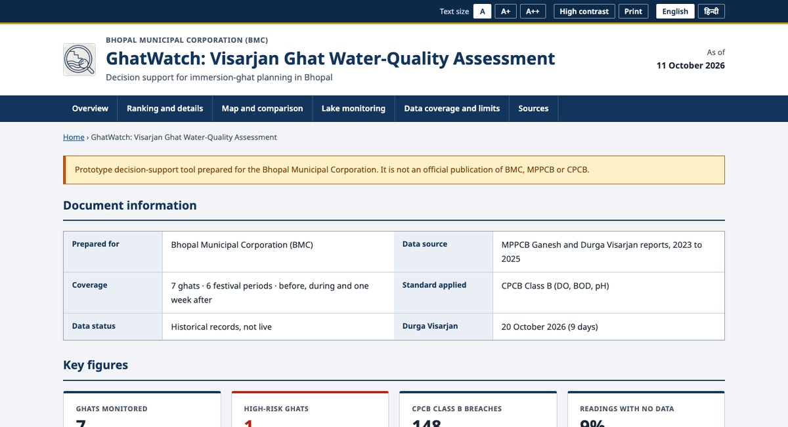

**Built for Track 2 (Visarjan Ghat Watch) of the Claude Impact Lab × Cerebras Café Compute hackathon, Bhopal, 11 October 2026.**
The one user is the BMC officer who plans Durga visarjan (20 October 2026) and decides where to send extra **cleaning, aeration and water testing**.

## Contents

1. [Tour](#tour)
2. [Features](#features)
3. [How the score works](#how-the-score-works)
4. [How it is built](#how-it-is-built)
5. [Data and traceability](#data-and-traceability)
6. [Run it locally](#run-it-locally) and [deploy](#deploy)
7. [Weekly public update](#weekly-public-update-off-by-default)
8. [Security](#security)
9. [Limitations](#limitations-stated-plainly)
10. [Data sources and credits](#data-sources-and-credits)

## Tour

**Ranking and ghat detail.** The seven ghats ranked by risk, with a score ring, the resource needs (aeration, cleaning, testing) and the missing-data warning.

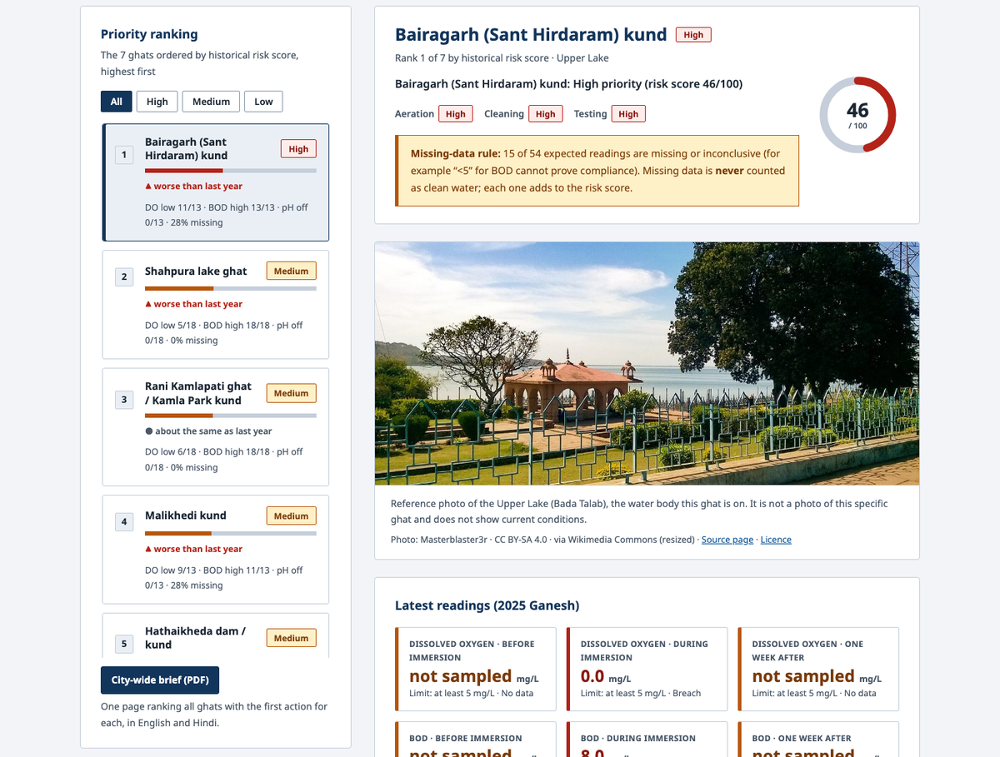

**A reference photo of the ghat's lake**, with its licence credit. It is clearly labelled as a photo of the water body, not of the specific ghat, and ghats with no openly licensed photo say so instead of showing a wrong one.

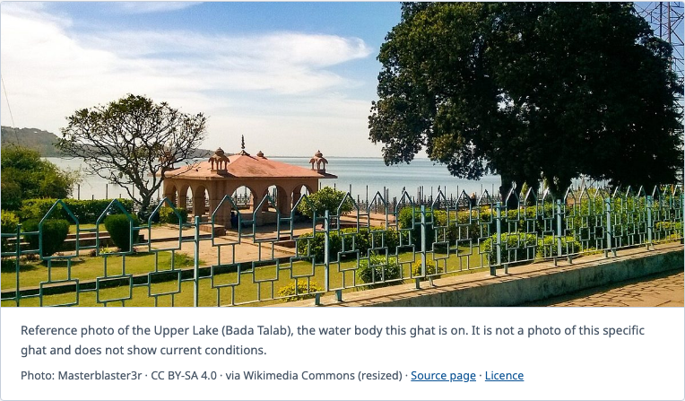

**Latest readings against the CPCB limits**, for dissolved oxygen, BOD and pH, before, during and one week after immersion. Green is within the limit, red is a breach, amber is no data.

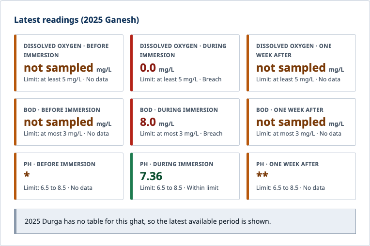

**Plain-language findings and recommended actions**, and trend charts for each parameter with the limit drawn on them. A break in a line means no reading, never "clean".

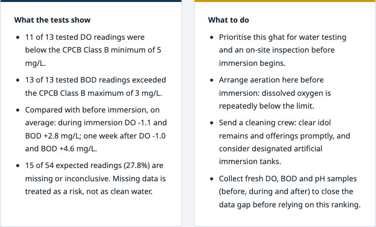
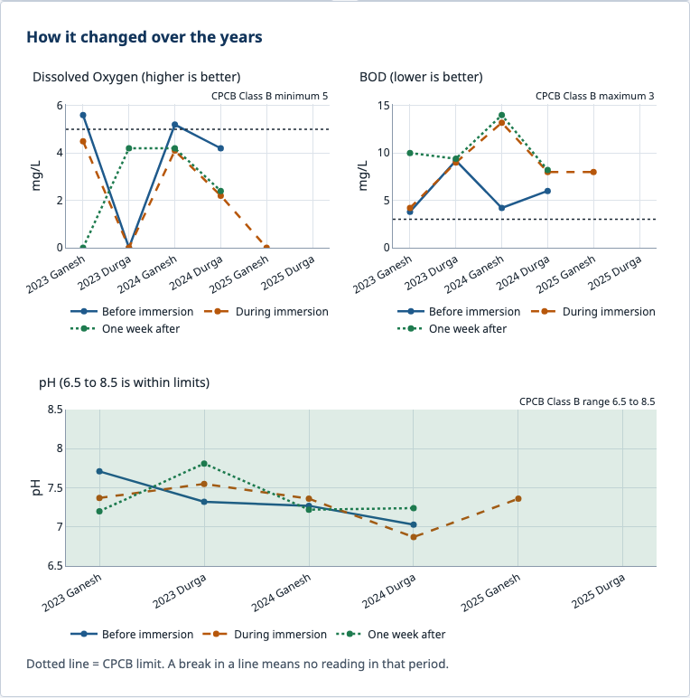

**Map of the ghats**, coloured by risk level (positions are approximate; see [limitations](#limitations-stated-plainly)).

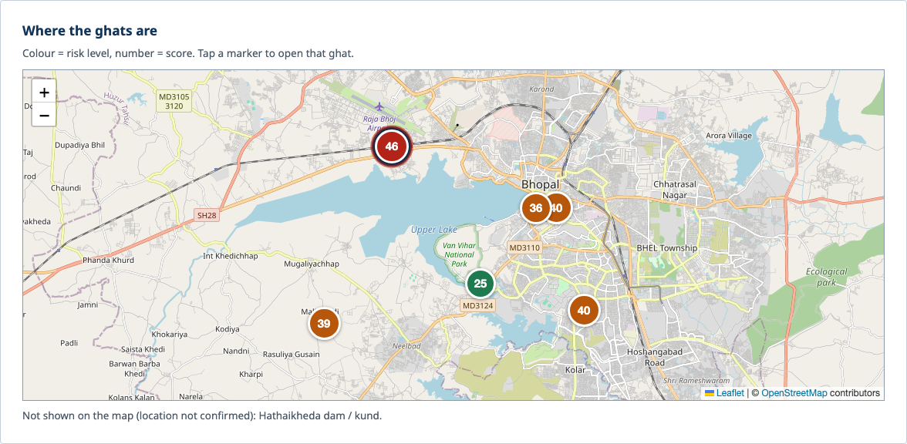

**Compare all ghats:** risk scores, a resource plan (where to send aeration, cleaning and testing), and a period-by-period grid where missing data is hatched.

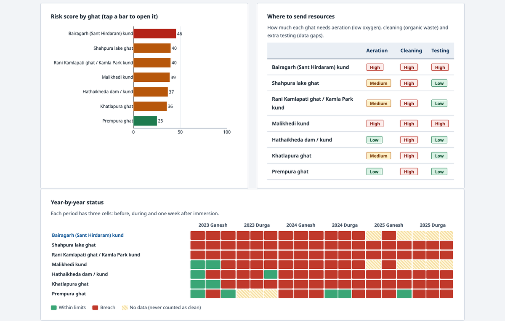

**Latest data: lake monitoring, April 2025 to March 2026**, shown beside each ghat on the Upper or Lower Lake as context (never scored), plus the full table for every station.

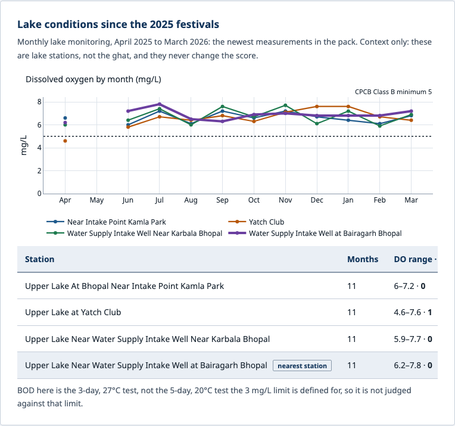
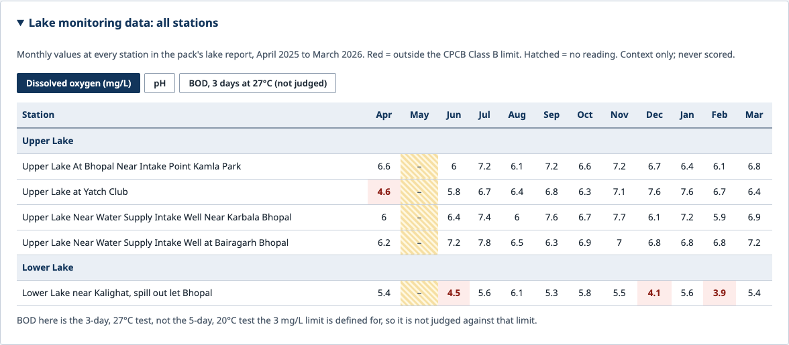

**Honest about gaps:** a "what this data does not cover" panel, built from the data and the guide's caveats.

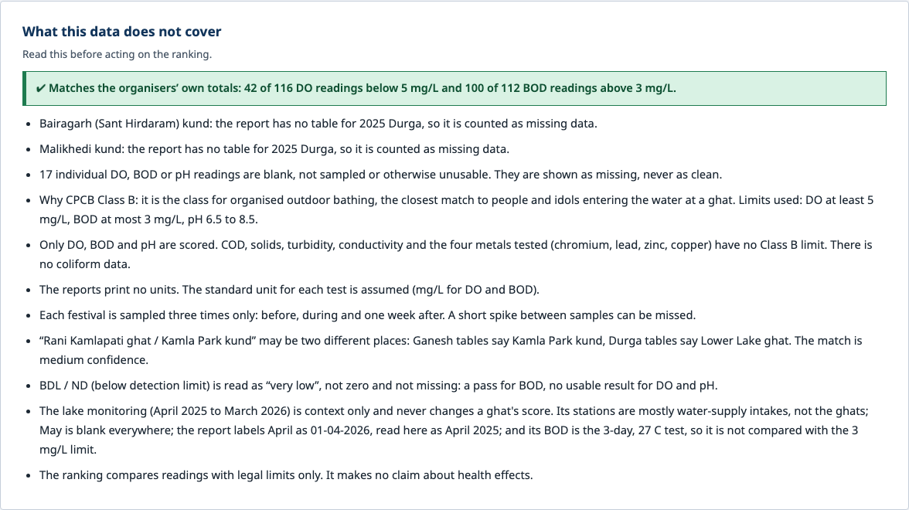

**One-page brief in English and Hindi**, per ghat and for the whole city.

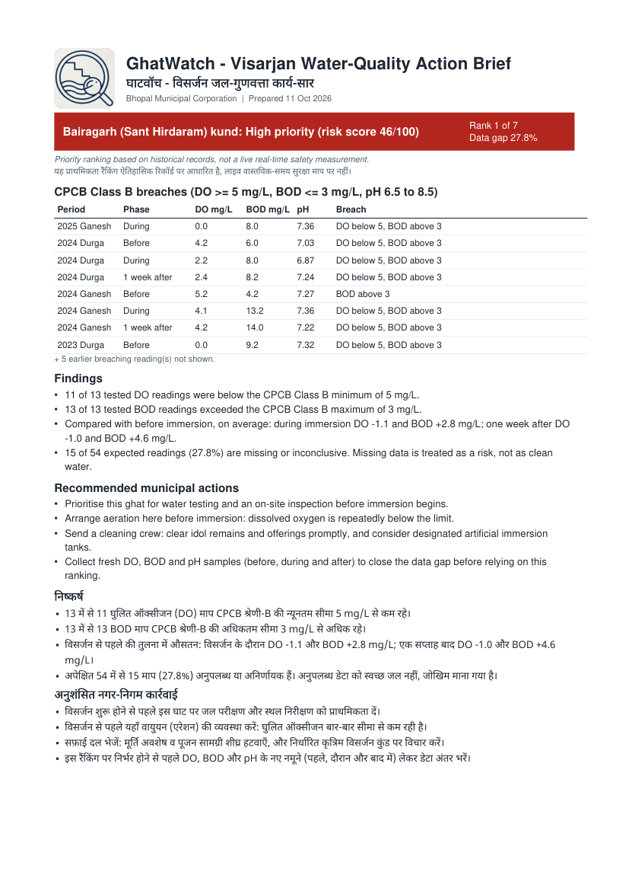

**Fully bilingual, accessible, and responsive:** Hindi interface, high-contrast mode, adjustable text size, and a phone layout.

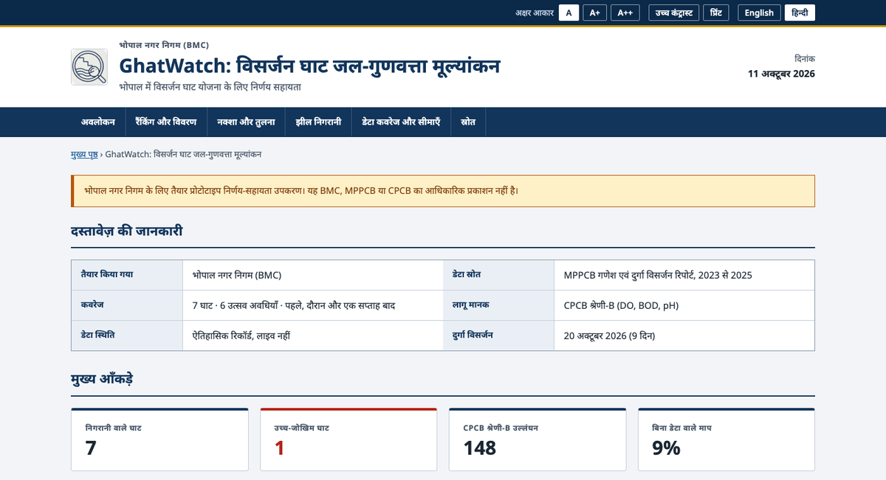
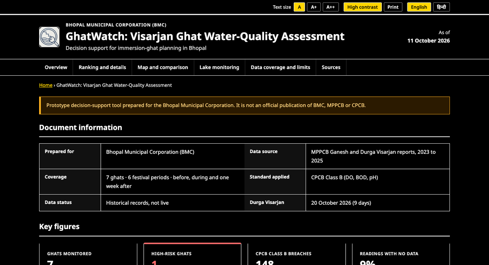

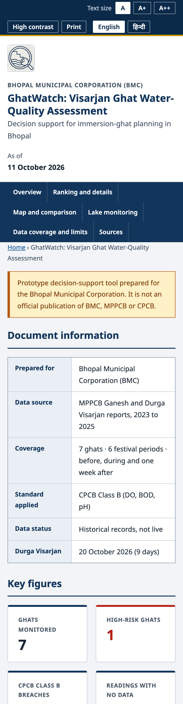

## Features

**What the problem asked for**

| Feature | What it does |
| --- | --- |
| Ranked list of the 7 ghats | A transparent risk score puts every ghat in High, Medium or Low. |
| The reason for each rank | Plain-language findings: how many readings broke a limit, and what changed during immersion. |
| Traceable numbers | Each reading shows its report and page, linked to the MPPCB PDF at that page. |
| CPCB Class B checks | Dissolved oxygen ≥ 5 mg/L, BOD ≤ 3 mg/L, pH 6.5 to 8.5, for every ghat, festival and phase. |
| Missing data is never clean | Blanks, "not sampled", `*`, `**` and absent tables count as missing and raise the risk. |
| Hindi and English brief | A one-page PDF per ghat and one for the whole city, plus a WhatsApp share. |
| Honest about the data | A panel listing what the data does not cover. |

**Beyond the brief**

| Feature | What it does |
| --- | --- |
| Resource plan | Per ghat: how much it needs **aeration** (low oxygen), **cleaning** (organic waste) and **extra testing** (data gaps). |
| Map | Real map of Bhopal with risk-coloured markers; click one to open that ghat. |
| Reference photos | An openly licensed, credited photo of the Upper or Lower Lake for ghats on them; clearly not a photo of the ghat itself. |
| Period-by-period grid | Every ghat and festival period, with before / during / one week after cells; missing data is hatched. |
| Latest lake monitoring | Monthly lake data, Apr 2025 to Mar 2026 (the newest in the pack), as context that never changes a score. |
| Trend and countdown | Better or worse than last year for each ghat, and days left to Durga Visarjan. |
| Verified totals | The engine reproduces the organisers' own totals: **42 of 116** DO readings below 5 mg/L and **100 of 112** BOD readings above 3 mg/L. |
| Simple, spacious layout | Generous spacing; secondary material (the full lake table, the weekly update, the score explanation) is folded away until you open it. |
| Full Hindi interface | One click switches the whole site, including ghat names. |
| Accessibility | Skip link, text size A / A+ / A++, high-contrast mode, keyboard use, screen-reader labels and a print view. |
| Weekly public update | A bilingual caption with "how to avoid mistakes" tips; auto-posting is built but **off by default**. |

## How the score works

```
score = 100 × ( 0.60 × breach rate  +  0.25 × severity  +  0.15 × impact of immersion )
```

| Part | Weight | Meaning |
| --- | --- | --- |
| Breach rate | 60% | Share of DO, BOD and pH readings outside the CPCB Class B limit. Recent periods weigh more. **Each missing reading counts as half a breach.** |
| Severity | 25% | How far the breaching values are past the limit. |
| Impact of immersion | 15% | Average fall in DO and rise in BOD from before to during immersion. |

- **Levels:** High ≥ 45, Medium ≥ 30, otherwise Low. These cut-offs are a starting point to agree with BMC, not an official standard.
- **Safety floor:** a ghat with more than 25% missing data cannot rate Low; it is held at Medium until it is re-tested.
- **Resource needs:** aeration and cleaning are High at 50% or more breaches of DO or BOD (Medium at 20%); testing is High at 25% or more missing data (Medium at 10%).
- **Why Class B:** it is the class for organised outdoor bathing, the closest match to people and idols entering the water at a ghat.
- Every ghat page has a "How this score is built" panel showing each part's value.

## How it is built

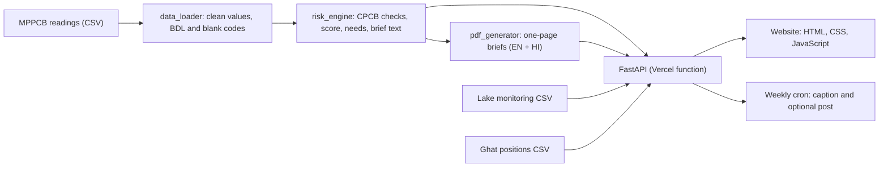

One scoring engine feeds the website, the API and the PDFs, so they cannot disagree.

| Layer | Technology |
| --- | --- |
| Backend | Python 3.12, FastAPI, pandas, numpy |
| Frontend | Plain HTML, CSS and JavaScript (no framework, no build step) |
| Charts and map | Plotly.js, Leaflet with OpenStreetMap |
| PDFs | ReportLab, with HarfBuzz and a bundled Noto Sans Devanagari font so Hindi is spelt correctly on any server |
| Hosting | Vercel (serverless function, static files, weekly cron) |

```
api/index.py            FastAPI backend: one Vercel function
public/                 the website: index.html, style.css, app.js, icon, images/ghats (reference photos)
utils/
  data_loader.py        reads the CSV: BDL / blank codes, periods, phases
  risk_engine.py        CPCB limits, score, resource needs, brief text
  caveats.py            "what this data does not cover"
  lakes.py              lake monitoring data
  locations.py          map positions
  i18n.py               English and Hindi interface text
  pdf_generator.py      one-page PDFs (English + Hindi)
  photos.py             reference-photo catalogue and credits
  weekly.py, publish.py weekly caption and optional social posting
  sources.py, clock.py  report links; India-time dates
data/                   readings, lake monitoring, ghat positions (see data/README.md)
fonts/                  Devanagari font for the PDFs
scripts/                extract_lake_monitoring.py (needs pymupdf; not used at runtime)
docs/screenshots/       the images in this README
assets/icon.png         logo used in the PDFs (the website uses public/icon.png)
vercel.json             headers, cron schedule, function settings
```

## Data and traceability

`data/bhopal_ghats_2023_2025.csv` holds every reading at the 7 ghats for 2023 to 2025, Ganesh and Durga, before, during and one week after
(1,524 rows, one per ghat, year, festival, phase and parameter). GhatWatch scores three parameters: dissolved oxygen, BOD and pH, the ones with a CPCB Class B limit.

| In the data | How it is treated |
| --- | --- |
| a number | checked against the Class B limit |
| `<2` | below 2: a pass for BOD (provably under 3), no data for DO |
| `BDL`, `ND` | below detection, "very low": a pass for BOD, no usable result for DO and pH |
| blank, `NA`, `_`, `-`, `*`, `**`, `not sampled` | missing, **never** counted as clean |
| a whole festival table absent from a report | missing, shown as a gap |

Each reading carries its source page; the site links it to the matching MPPCB report (the year's PDF, opened at that page).
The loader never crashes on bad input: an empty, wrong or broken file falls back to clearly labelled demo data.
See [`data/README.md`](data/README.md) for the file formats.

## Run it locally

```bash
git clone https://github.com/priyanxs/ghatwatch.git && cd ghatwatch
python3 -m venv .venv
.venv/bin/pip install -r requirements-dev.txt
.venv/bin/uvicorn api.index:app --reload
# open http://localhost:8000
```

To update the data, replace `data/bhopal_ghats_2023_2025.csv` with a file in the same format.

## Deploy

Import the repository on [vercel.com/new](https://vercel.com/new); no build command or framework preset is needed. The Python version comes from
`.python-version` and the dependencies from `requirements.txt`.

## API

| Route | Returns |
| --- | --- |
| `GET /api/overview` | metrics, limits, weights, ranking, resource needs, period grid, caveats, lake data, sources |
| `GET /api/ghats/{id}` | summary, every reading with its CPCB status, bilingual brief |
| `GET /api/ghats/{id}/brief.pdf` | one-page English + Hindi brief for a ghat |
| `GET /api/readiness.pdf` | one-page brief ranking all ghats |
| `GET /api/weekly-report` | this week's captions (preview; never posts) |
| `GET /api/cron/weekly-post` | cron only; posts when configured |
| `GET /api/i18n` | interface strings (English and Hindi) |
| `GET /api/docs` | interactive API docs (local development only) |

## Weekly public update (off by default)

A bilingual caption is written from the latest ranking, with three tips on avoiding common mistakes that rotate weekly. The captions are fixed
templates filled with real numbers, **never AI-generated**, so nothing invented can be posted. Vercel Cron calls `/api/cron/weekly-post` every
Monday at 09:00 IST. Nothing is posted unless these environment variables are set in Vercel (never in code):

| Variable | Purpose |
| --- | --- |
| `CRON_SECRET` | required; the endpoint is disabled without it |
| `POST_ENABLED=true` | master switch; otherwise every run is a dry run |
| `TELEGRAM_BOT_TOKEN`, `TELEGRAM_CHAT_ID` | a Telegram channel or group |
| `MASTODON_BASE_URL`, `MASTODON_ACCESS_TOKEN` | a Mastodon account |
| `SOCIAL_WEBHOOK_URL` | any https webhook (Zapier, Make, IFTTT) to reach X, Facebook, LinkedIn or Instagram |

Demo data is never posted. Preview this week's captions at `/api/weekly-report`.

## Security

A read-only site: no logins, no uploads, no database. A strict Content-Security-Policy and other browser protections, Subresource Integrity on
outside scripts, escaped output, a locked-down weekly-post endpoint, and pinned, audited dependencies. See [`SECURITY.md`](SECURITY.md).

## Limitations, stated plainly

- It ranks **historical records**; it is not a live measurement, and it makes no claim about health effects.
- **Map positions are not field-verified.** The data has no coordinates, so positions come from OpenStreetMap lookups: only Prempura ghat is an exact feature;
  the rest are the centre of their lake or locality. **Hathaikheda dam / kund** was not found and is left off the map. Fix or add positions in `data/ghat_locations.csv`.
- The **score cut-offs** (High ≥ 45, Medium ≥ 30) are a starting point to agree with BMC, not an official standard.
- Only DO, BOD and pH have a Class B limit, so only they are scored. There is no coliform data, and only four metals were tested.
- The **lake monitoring** covers only the Upper and Lower Lake stations (mostly water-supply intakes, not the ghats), May is blank, and its BOD is the 3-day, 27°C test,
  so it is not judged against the 3 mg/L limit. It never changes a score.
- **Reference photos** exist only for ghats on the Upper and Lower Lake. None was found for Shahpura Lake, Hathaikheda dam or Malikhedi kund, so those show a note instead.
  They are photos of the lake, not of the individual ghats, and do not show current conditions. (Wikimedia Commons files titled "Shahpura" turned out to show Shahpura in Rajasthan, so they were not used.)
- "Rani Kamlapati ghat / Kamla Park kund" may be two places (medium match confidence). Bairagarh and Malikhedi have no Durga 2025 table in the report.
- Each festival is sampled only three times, so a short spike between samples can be missed.
- Weekly auto-posting is built but has not been tested against a live account.
- The page loads fonts, charts and map tiles from public CDNs, so it needs internet access.

## Data sources and credits

- **Readings:** the Track 2 participant pack, https://github.com/Laaaaksh/bhopal-impact-lab-2026 (`tracks/02-visarjan-ghat-watch`), extracted from the MPPCB reports:
  [Ganesh and Durga Visarjan 2025](https://www.mppcb.mp.gov.in/proc/mon/Ganesh_and_Durga_visarjan_report-2025.pdf),
  [2024](https://www.mppcb.mp.gov.in/proc/mon/Ganesh_and_Durga_visarjan_report-2024.pdf) and
  [Idol Immersion Report 2023, CPCB format](https://www.mppcb.mp.gov.in/proc/mon/Idol_immer._Report_23_CPCB.pdf).
- **Limits:** [CPCB water quality criteria](https://cpcb.gov.in/water-quality-criteria/), Class B.
- **Lake monitoring:** [Upper and Lower Lake monthly water quality 2025-26](https://xgn.mp.nic.in/File_Upload/MONITORING//Yearly%20Water%20Quality%20Status/2026/July/UPPER%20LAKE-2025-26..pdf),
  read from the copy in the pack, extracted by `scripts/extract_lake_monitoring.py` and checked against the PDF's own averages, maxima and minima.
- **Photos:** [Upper Lake (Bada Talab)](https://commons.wikimedia.org/wiki/File:Bada_talab(upper_lake)_Bhopal.jpg) and [Lower Lake](https://commons.wikimedia.org/wiki/File:Lower_lake_Bhopal.jpg) by Masterblaster3r,
  [CC BY-SA 4.0](https://creativecommons.org/licenses/by-sa/4.0), via Wikimedia Commons; resized. Credits are listed in `data/ghat_photos.csv` and shown under each photo.
- **Map:** © [OpenStreetMap](https://www.openstreetmap.org/copyright) contributors (positions and tiles), rendered with [Leaflet](https://leafletjs.com). Charts by [Plotly](https://plotly.com/javascript/).
- **Font:** Noto Sans Devanagari (SIL Open Font Licence), bundled so the Hindi PDFs work on a server.

No government system was logged into, scraped or written to.

## Author and team

Built by **Priyanshu Kushwaha**, Sagar Institute of Science and Technology, Gandhinagar, with Claude and Claude Code.

**Team:** _add team name and members here_

## Licence

MIT. See [`LICENSE`](LICENSE).
